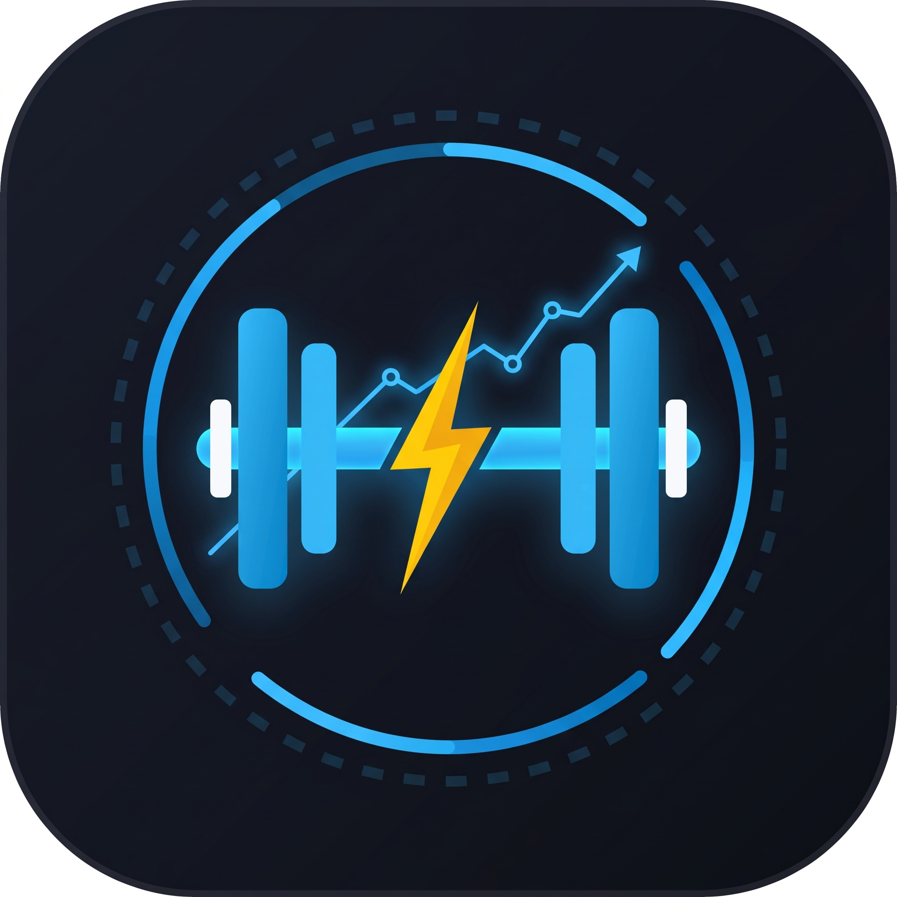

<div align="center">
  
  <h1>⚡ Gym Logbook Ultimate</h1>
  <p><strong>Logbook di allenamento Progressive Web App (PWA) con design iOS Liquid Glass, timer preciso in background, calcolo 1RM in tempo reale, rilevamento automatico dei Record Personali (PR) e backup ibrido in PDF.</strong></p>

  <p>
    
    
    
    
  </p>
</div>

---

## ✨ Panoramica

**Gym Logbook Ultimate** è una web app standalone progettata per tracciare gli allenamenti in sala pesi con la reattività di un'app nativa iOS, senza richiedere account, database esterni o connessione internet attiva. Tutti i dati rimangono salvati localmente sul dispositivo (`localStorage` con supporto a `navigator.storage.persist()`) e possono essere esportati o reimportati tramite un **singolo file PDF** leggibile e stampabile che incorpora al suo interno anche il payload strutturato di backup.

---

## 🚀 Funzionalità Principali

### 📅 1. Logbook Giornaliero & Calendario Intelligente
- **Calendario interattivo** con indicatori cromatici per sessioni **Registrate** (azzurro), **In corso / Bozze** (giallo) e **Programmate nel futuro** (ambra).
- **Pre-compilazione intelligente (Ghost Placeholders):** mostra automaticamente nei campi di input i carichi e le ripetizioni eseguiti nell'ultima sessione valida per quell'esercizio, oltre a un promemoria visivo delle note lasciate la volta precedente.
- **Tipi di Serie (Tag):** tocca il numero della serie per ciclare tra:
  - `N` — **Normale (Allenante)**
  - `W` — **Warmup (Riscaldamento):** esclusa automaticamente dal calcolo del volume allenante, dell'1RM e dei Record Personali
  - `D` — **Dropset**
  - `F` — **Failure (Cedimento)**
- **Protezione anti-tocco sulle serie completate:** una volta spuntata una serie (`✓`), i campi vengono bloccati contro modifiche involontarie e parte automaticamente il timer di recupero. Per correggere una serie già confermata senza far ripartire il timer, basta usare il pulsante **✏️ Modifica** o tenere premuto sulla spunta.
- **Modalità Sola Lettura per il passato:** le sessioni dei giorni passati vengono aperte in sola lettura per preservare l'integrità dello storico.
- **Navigazione Esercizi compatta:** stepper rapido (`‹` / `›`) per scorrere un esercizio alla volta o vista espansa **Tutti gli esercizi**, con possibilità di rimuovere o ripristinare singoli esercizi nella sessione corrente.
- **Calcolatore Dischi Bilanciere integrato:** calcola e disegna graficamente i dischi da caricare per singolo lato (`20`, `10`, `5`, `2.5`, `1.25` kg) selezionando il peso target e il bilanciere (`20`, `15` o `10` kg).

### 🏆 2. Rilevamento Automatico Record Personali (PR) & Calcolo 1RM
- **Stima 1RM in tempo reale** sotto ogni serie tramite **Formula di Epley**:
  $$\text{1RM} = \text{Peso} \times \left(1 + \frac{\text{Ripetizioni}}{30}\right)$$
- **Evidenziazione Oro (PR):** le serie che stabiliscono il primato attuale di un esercizio vengono incorniciate in oro in tempo reale, con comparsa del banner **👑 Nuovo record in questo allenamento!**.
- **Bacheca Record Personali:** sezione dedicata nella scheda *Progressi* con ricerca testuale, ordinamento per data, carico o nome esercizio, e pulsante **📅 Vai all'allenamento →** per saltare direttamente alla sessione e alla serie esatta del record.

### 📋 3. Costruttore Schede & ID Stabili
- **Visual Workout Builder:** crea e modifica le tue schede definendo nome esercizio, numero di serie, tempo di recupero specifico (`30s` – `240s`), riordinamento rapido (`↑` / `↓`) e note fisse di scheda.
- **Tracciamento tramite UUID (`exerciseId`):** ogni esercizio possiede un identificatore univoco persistente. Se rinomini un esercizio, l'app mantiene intatto il legame con lo storico e i grafici e ti chiede se desideri aggiornare il nome anche nelle sessioni passate.

### 📈 4. Analisi Progressi & Grafico Canvas Retina
- **Grafico interattivo su HTML5 Canvas** ad alta densità di pixel (Retina / HiDPI) con curva di Bézier morbida, area sfumata e indicatori dorati sui punti di Record Personale.
- **Filtri avanzati:** intervalli rapidi (`1 Mese`, `3 Mesi`, `6 Mesi`, `1 Anno`, `Tutto`) o selettore mese/anno personalizzato, filtrabili per singola scheda o singolo esercizio.
- **Metriche selezionabili per esercizio:** **Peso Max**, **1RM Stimato** o **Volume Totale**.
- **Ispettore Punto & Livello Prestazione:** tocca o trascina il dito sul grafico per ispezionare data, variazione percentuale rispetto alla sessione precedente, miglior set e classificazione della sessione (*Record Personale*, *Livello Élite*, *Livello Solido*, *Costruzione / Scarico*).
- **KPI rapidi:** Variazione percentuale nel periodo, numero di sessioni e **Costanza (Streak di settimane consecutive 🔥)**.

### ⏱️ 5. Timer di Recupero & Cronometro Background-Safe
- **Doppio strumento:** Cronometro durata sessione (con pillola live nell'header) e Timer Pausa Recupero con ghiera circolare SVG e **Live Activity Pill fluttuante** visibile in qualsiasi schermata.
- **Precisione al millisecondo in background su iOS/Android:** combina timestamp assoluti (`Date.now()`), un **Web Worker ticker** dedicato e un canale **Web Audio API** in modalità `ambient` (`Mixato con Musica`) per impedire a iOS Safari di congelare il conto alla rovescia quando lo schermo è bloccato o l'app è in background, **senza interrompere Spotify o Apple Music**.
- **Sintetizzatore Audio Web Audio API integrato:** 6 suonerie generate matematicamente in locale (*Beep classico*, *Doppio squillo*, *Campanello*, *Allarme*, *Arpeggio*, *Gong grave* + *Silenzioso*), controllo volume, vibrazione aptica e notifiche di sistema.

### 📄 6. Backup & Condivisione PDF Ibrido
- **Esportazione PDF impaginata:** genera un report PDF pulito e pronto per la stampa (filtrabile per intervallo di date e con sezione opzionale *Record personali*), evidenziando i PR con un'icona trofeo dorata.
- **Backup strutturato incorporato nel PDF:** lo stesso file PDF contiene al suo interno l'intero archivio dati codificato e protetto da checksum FNV-1a (`%GYMLOG_ULTIMATE_BACKUP_V2_START%`).
- **Importazione Intelligente:** puoi selezionare un file `.pdf` generato dall'app (o un backup `.json` legacy) e scegliere se **🔗 Unire ai dati esistenti** (senza duplicati) oppure **🔄 Sostituire tutti i dati attuali**.

### 🎨 7. Personalizzazione & UX Nativa
- **Design iOS 26 Liquid Glass:** notifiche *Dynamic Island* con supporto swipe-to-dismiss, modali trascinabili verso il basso (*drag-to-dismiss*) e navigazione tra le 5 tab con **swipe orizzontale 1:1 interrompibile** a metà corsa.
- **Temi e Unità:** modalità **Scuro** / **Chiaro**, 5 colori di accento (*Sky*, *Emerald*, *Violet*, *Orange*, *Rose*), conversione istantanea **Chilogrammi (`kg`) / Libbre (`lbs`)** e opzione **Schermo Sempre Acceso** tramite *Screen Wake Lock API*.

---

## 🗂️ Struttura del Progetto

```text
├── index.html      # Applicazione completa (UI Liquid Glass, CSS e logica JS)
├── manifest.json   # Web App Manifest per installazione PWA standalone
├── sw.js           # Service Worker (Offline-first, Cache-First CDN + Stale-While-Revalidate)
└── icon.png        # Icona applicazione (512x512)
```

---

## 📲 Installazione e Utilizzo

### Utilizzo su Smartphone (Consigliato)
1. Pubblica il repository su **GitHub Pages** (o qualsiasi hosting statico HTTPS).
2. Apri l'URL da **Safari su iOS** o **Chrome su Android**.
3. **Su iOS:** tocca il pulsante **Condividi** (`⬆️`) → **Aggiungi alla schermata Home**.
4. **Su Android:** tocca il menu (`⋮`) → **Installa app** / **Aggiungi a schermata Home**.
5. Avvia **Gym Log** dalla schermata Home: funzionerà a schermo intero e completamente offline.

### Avvio in Locale per Sviluppo
Poiché il Service Worker (`sw.js`) richiede il protocollo `http://` su `localhost` o `https://`, avvia un piccolo server statico nella cartella del progetto:

```bash
# Con Python 3
python3 -m http.server 8080

# Oppure con Node.js (npx)
npx serve .
```

Poi apri `http://localhost:8080` nel browser.

---

## 🛠️ Tecnologie Utilizzate

- **Frontend:** HTML5 semantico, CSS3 Custom Properties, Backdrop Filter (`blur` / `saturate`), HTML5 Canvas 2D, SVG.
- **Logica & Storage:** Vanilla JavaScript (ES6+), `localStorage`, `StorageManager.persist()`, `Web Workers API`, `Web Audio API`, `Screen Wake Lock API`, `Notifications API`, `File System Access API` & `Web Share API`.
- **Librerie PDF (caricate in lazy-loading e messe in cache dal Service Worker):**
  - [`jsPDF`](https://github.com/parallax/jsPDF) + [`jsPDF-AutoTable`](https://github.com/simonbengtsson/jsPDF-AutoTable) per il rendering tipografico delle tabelle di allenamento.
  - [`pdf-lib`](https://pdf-lib.js.org/) per i metadati e gli allegati strutturati all'interno del documento PDF.